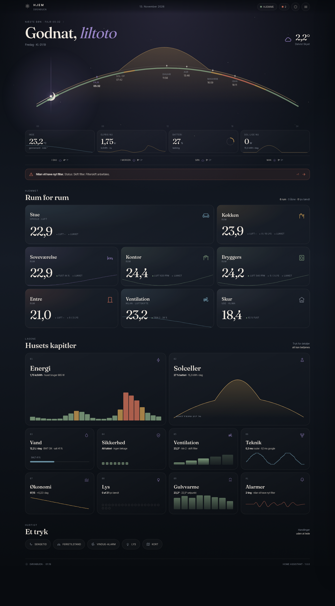

# Arcus

**The arc of the day.** A calm, custom Home Assistant dashboard built around the rhythm of the home.

Arcus is a Dashboard plugin for the Home Assistant Marketplace. It installs as one bundled frontend module and adds:

- a custom card, `custom:arcus-card`
- a dashboard strategy, `custom:arcus`
- a visual editor for the card and the strategy



## Installation

<!-- ha-marketplace:exclude-start -->
### GitHub

Add this repository as a custom repository in **Settings → Marketplace**, or install it through HACS on Home Assistant 2026.10 and older.
<!-- ha-marketplace:exclude-end -->

1. Open **Settings → Marketplace**.
2. Choose **Dashboard** and install **Arcus**.
3. Reload the browser.
4. Create a dashboard with the **Arcus** strategy, or add `custom:arcus-card` to an existing dashboard.

## Configuration

```yaml
strategy:
  type: custom:arcus
  dashboard_title: Hjem
  view_title: Hjem
  card:
    title: HJEM
    subtitle: ARCUS
    language: auto
    appearance: auto
    atmosphere: auto
    density: comfortable
```

See [`examples/hjem.yaml`](examples/hjem.yaml) for a full example.

## Development

```bash
npm install
npm run dev
npm run test
npm run build
```

The development harness runs at `http://localhost:5173/dev/index.html`.

## Roadmap

- [x] Repository scaffold, build, Marketplace manifest
- [ ] Config, localization, formatting
- [ ] Design system with embedded fonts
- [ ] Area/entity discovery and dynamic model
- [ ] Card and sheet views
- [ ] Visual editor
- [ ] Dashboard strategy
- [ ] Visual regression and responsive QA
- [ ] Marketplace release
- [ ] Migration of the current `hjem-dognet` dashboard

The full implementation plan lives in the project plan; the current `hjem-dognet` dashboard is untouched until the Arcus dashboard is verified.

## License

MIT. Fraunces and Inter Tight are licensed under the SIL Open Font License; their license files ship with the embedded font assets.
