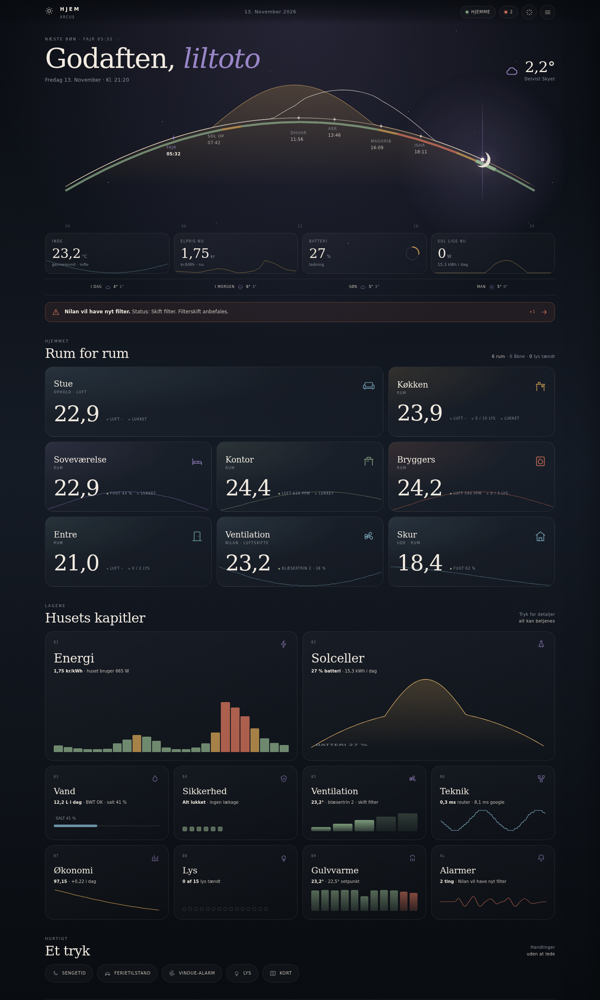
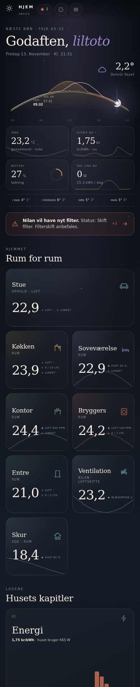

# Arcus

**The arc of the day.** A calm, custom Home Assistant dashboard built around the rhythm of the home.

Arcus is a Dashboard plugin for the Home Assistant Marketplace. It installs as one bundled frontend module and adds:

- a custom card, `custom:arcus-card`
- a dashboard strategy, `custom:arcus`
- a visual editor for the card and the strategy





## What Arcus does

- **Rooms from your registries.** Arcus reads Home Assistant's areas, devices, and entities. A room appears when it has an area; its temperature, humidity, air quality, lights, openings, climate, media, leak sensor, and battery are discovered automatically.
- **The arc of the day.** Prayer times, sunrise, the solar curve, and the hour-by-hour price sit on one arc, so the dashboard shows where the day is.
- **Chapters that earn their place.** Energy, solar, water, security, ventilation, tech, economy, lights, heating, and alerts only appear when there is data for them.
- **Sheets for the details.** Room, light, heating, ventilation, energy, solar, water, security, tech, economy, prayer, and alert sheets use the same visual language as the home view.
- **A dashboard that follows your home.** The strategy generates one panel view containing the card. When you add an area or rename a device, the card rebuilds without a dashboard edit.
- **Made for the house, not a demo.** Danish and English, automatic dark and light appearance, four times of day, comfortable and compact density, and a 360 px mobile layout.
- **Keyboard and motion aware.** Sheets trap focus, close on Escape, and transitions respect `prefers-reduced-motion`.

## Requirements

- Home Assistant **2026.11.0** or newer.
- Areas in Home Assistant. Arcus works with an empty home, but there is nothing to show until areas and entities exist.

## Installation

Arcus is installed from the Marketplace. If it is not in the catalog yet, add the repository from its GitHub link first.

1. Open **Settings → Marketplace**.
2. Select **Add from link** in the upper-right corner.
3. Enter `https://github.com/liltoto/ha-arcus` and select **Add**. If the Marketplace asks for a type, choose **Dashboard**.
4. Open **Arcus** and select **Install**.
5. Reload the browser. A hard refresh (`Ctrl+Shift+R`, or `Cmd+Shift+R` on macOS) makes sure the new module is loaded.
6. Create the dashboard, or add the card to an existing one (see below).

Adding a custom repository needs a GitHub connection. The Marketplace asks you to connect GitHub if you have not already; it only reads public repository information.

### Create the dashboard

1. Open **Settings → Dashboards → Add dashboard**.
2. In the strategy picker, choose **Arcus**. If the picker does not offer it, create a dashboard from scratch and paste the strategy YAML below into the raw configuration editor.
3. Save and open the dashboard.

```yaml
strategy:
  type: custom:arcus
  dashboard_title: Hjem
  view_title: Hjem
  card:
    type: custom:arcus-card
    language: auto
    appearance: auto
    atmosphere: auto
    density: comfortable
```

The strategy generates one panel view with a single `custom:arcus-card`. The card fills the view and handles the room grid, chapters, and sheets.

To use the card on an existing dashboard instead, edit the dashboard, choose **Add card**, and search for **Arcus**. In YAML:

```yaml
type: custom:arcus-card
```

<!-- ha-marketplace:exclude-start -->
## Install from GitHub

### HACS on Home Assistant 2026.10 and older

1. Open **HACS → Frontend**.
2. Open the three-dot menu, choose **Custom repositories**, and add `https://github.com/liltoto/ha-arcus` with category **Dashboard**.
3. Install **Arcus** and reload the browser.

### Manual installation

1. Download `arcus.js` from the [latest release](https://github.com/liltoto/ha-arcus/releases/latest).
2. Copy it to `config/www/community/ha-arcus/arcus.js`.
3. Open **Settings → Dashboards → Resources** and add `/local/community/ha-arcus/arcus.js?v=0.2.3` as a **JavaScript module**.
4. Reload the browser.

[](https://my.home-assistant.io/redirect/marketplace_repository/?owner=liltoto&repository=ha-arcus&category=plugin)
<!-- ha-marketplace:exclude-end -->

## Configuration

Every option works in the strategy's `card` block and in a standalone `custom:arcus-card`. The strategy also accepts card options at its top level; the nested `card` block is clearer when the dashboard and card settings live together.

### Layout and language

```yaml
type: custom:arcus-card
title: HJEM
subtitle: ARCUS
language: auto          # auto | da | en
appearance: auto        # auto | dark | light
atmosphere: auto        # auto | night | dawn | day | dusk
density: comfortable    # comfortable | compact
show_weather_forecast: true
```

| Option | Default | Description |
| --- | --- | --- |
| `title` | `HJEM` | The wordmark in the top bar. |
| `subtitle` | `ARCUS` | The small line under the wordmark. |
| `language` | `auto` | `auto` follows the Home Assistant profile language. Danish and English ship; other languages fall back to English. |
| `appearance` | `auto` | `auto` follows the active Home Assistant theme. `dark` and `light` pin the palette. |
| `atmosphere` | `auto` | `auto` follows the time of day: night, dawn, day, or dusk. |
| `density` | `comfortable` | `comfortable` is the designed layout; `compact` tightens card padding, grid gaps, and sheet padding. |
| `show_weather_forecast` | `true` | Show the short forecast strip under the vitals. |

### Areas

`areas` accepts a list of area IDs, or an object with `include`, `exclude`, and `order`.

```yaml
areas:
  include: [stue, kokken, sovevaerelse, kontor]
  exclude: [skur]
  order: [stue, kokken, sovevaerelse, kontor]
```

| Key | Description |
| --- | --- |
| `include` | Only these area IDs. An empty list means every area. |
| `exclude` | Remove these area IDs. `exclude` wins over `include`. |
| `order` | Put these areas first, in this order. The remaining areas follow the area registry order. |

Area IDs come from **Settings → Areas**, not from the display names. A plain list is shorthand for `include`:

```yaml
areas: [stue, kokken]
```

### Data sources

Arcus discovers rooms on its own. The global sections below connect the chapters that are not tied to a single area. Every key is optional; a chapter stays hidden until its data exists.

```yaml
weather: weather.home

price:
  current: sensor.electricity_price
  sell: sensor.electricity_sell_price
  forecast: sensor.electricity_forecast
  spot: sensor.nord_pool_current_price
  lowest: sensor.nord_pool_lowest_price
  highest: sensor.nord_pool_highest_price
  next: sensor.nord_pool_next_price
  previous: sensor.nord_pool_previous_price
  tomorrow: binary_sensor.nord_pool_tomorrow_available

solar:
  power: sensor.solar_power
  today: sensor.solar_today
  forecastToday: sensor.solar_forecast_today
  forecastTomorrow: sensor.solar_forecast_tomorrow
  batterySoc: sensor.battery_soc
  load: sensor.home_load
  grid: sensor.grid_power
  batteryPower: sensor.battery_power

prayers:
  fajr: sensor.fajr
  dhuhr: sensor.dhuhr
  asr: sensor.asr
  maghrib: sensor.maghrib
  isha: sensor.isha
  sunrise: sensor.sunrise

water:
  state: sensor.water_state
  flow: sensor.water_flow
  day: sensor.water_today
  month: sensor.water_month
  year: sensor.water_year
  total: sensor.water_total
  cost: sensor.water_cost
  salt: sensor.water_salt
  saltDays: sensor.water_salt_days
  capacity: sensor.water_capacity
  holiday: input_boolean.water_holiday

network:
  router: sensor.router_latency
  routerState: binary_sensor.router_online
  google: sensor.google_latency
  cloudflare: sensor.cloudflare_latency
  packetLoss: sensor.packet_loss
  jitter: sensor.jitter
  wifiSignal: sensor.wifi_signal
  uptime: sensor.uptime

economy:
  bond: sensor.bond_price
  change: sensor.bond_change
  yield: sensor.bond_yield
  duration: sensor.bond_duration

ventilation:
  climate: climate.ventilation
  temperature: sensor.ventilation_temperature
  humidity: sensor.ventilation_humidity
  step: sensor.ventilation_step
  filter: sensor.ventilation_filter
  outdoor: sensor.outdoor_temperature
  efficiency: sensor.heat_exchange_efficiency

security:
  windowAlert: input_boolean.window_alert
  windows: sensor.open_windows
  leaks:
    - binary_sensor.kitchen_leak
    - binary_sensor.bathroom_leak
  batteries:
    - sensor.door_battery
    - sensor.window_battery
```

See [`examples/hjem.yaml`](examples/hjem.yaml) for the complete home configuration used during development, including the detailed solar and ventilation keys.

### Auto-discovery

Arcus reads the area, device, and entity registries and rebuilds when they change. It does not use hardcoded entity IDs.

- A room is an area. Its name and icon come from the area registry.
- An entity belongs to a room when its own `area_id` matches, or when it has no area and its device is in that area.
- Hidden, disabled, diagnostic, and configuration entities are skipped.
- A light group is used as the room's master light, and its members are not shown twice.
- Openings, leak sensors, climate, media players, and batteries are matched by domain and device class.
- A missing or unavailable entity renders as `–`; it never breaks the card.

Add a room override only where discovery needs help:

```yaml
rooms:
  stue:
    temp: sensor.stue_temperature
    humidity: sensor.stue_humidity
    lights: [light.stue]
    openings: [binary_sensor.stue_window]
  kokken:
    name: Køkken
    tint: "#c98a5e"
```

Room keys: `temp`, `humidity`, `co2`, `pm25`, `lights`, `openings`, `climate`, `media`, `leak`, `battery`, `name`, and `tint`. `openings` accepts entity IDs or `{ id, name, kind }` objects.

### Chapters

Chapters appear automatically when they have data. Force one off or on with:

```yaml
chapters:
  sol: false
  alarmer: true
```

The keys are `energi`, `sol`, `vand`, `sikkerhed`, `ventilation`, `teknik`, `oekonomi`, `lys`, `varme`, and `alarmer`.

### Quick actions

Without configuration, Arcus shows the default actions whose entities exist: bedtime, vacation mode, the window alert switch, lights, and the map. `quick_actions` replaces that list.

```yaml
quick_actions:
  - label: Sengetid
    icon: moon
    entity: input_button.bedtime
    action:
      action: perform-action
      perform_action: input_button.press
      target:
        entity_id: input_button.bedtime

  - label: Ferietilstand
    icon: car
    entity: input_boolean.vacation_mode
    action:
      action: perform-action
      perform_action: input_boolean.toggle
      target:
        entity_id: input_boolean.vacation_mode

  - label: Kort
    icon: map
    action:
      action: navigate
      navigation_path: /map
```

Supported actions are `perform-action` (and the older `call-service`), `toggle`, `navigate`, and `url`. `icon` is an Arcus icon name such as `moon`, `car`, `wind`, `light`, or `map`.

### Visual editor

The card editor exposes the title, subtitle, language, appearance, atmosphere, density, area selection, and the global entity fields. Quick actions, room overrides, and chapters live in the advanced JSON block. The strategy editor adds the dashboard and view titles and embeds the same card editor, so there is one implementation for both entry points.

## Troubleshooting

**The dashboard is empty.** Arcus shows a calm empty state when no areas exist. Create areas in **Settings → Areas**, assign devices or entities to them, then reload. Also check that `areas.include` is not listing area IDs that no longer exist; an empty `include` list means all areas.

**A room is missing an entity, or a value shows `–`.** The entity may be hidden, disabled, diagnostic, or not assigned to the area or its device. Assign it in the entity settings, or add an explicit override under `rooms.<area_id>`. An unavailable entity intentionally shows `–` rather than a stale value.

**The card or strategy does not appear after an update.** Hard refresh the browser. The Marketplace adds the resource with a version query such as `?v=...`; a cached module can survive a normal reload. Check **Settings → Dashboards → Resources** for one Arcus entry and remove duplicates. If the `www` folder did not exist when Home Assistant started, restart Home Assistant once so the Marketplace can create it.

**The strategy is not in the picker.** Reload the browser and check the browser console for `Arcus v0.2.3`. If the module did not load, verify the resource URL and that its type is **JavaScript module**. You can always paste the strategy YAML into the raw dashboard editor.

**A configuration error appears.** Arcus reports the field that failed, for example `areas.include must be an array of strings`. Check that lists are lists, booleans are `true` or `false`, and enum values are spelled as shown above.

## Development

```bash
npm install
npm run dev        # development harness at http://localhost:5173/dev/index.html
npm run test       # Vitest
npm run typecheck  # tsc --noEmit
npm run build      # one self-contained dist/arcus.js
npm run visual     # Playwright visual checks (install browsers: npx playwright install chromium)
npm run build-storybook  # static component docs (npm run storybook for the dev server)
npm run size       # 400 KB gzip budget for dist/arcus.js
```

The dashboard UI is a React tree mounted inside the card's shadow DOM, organized
by atomic design under `src/ui/`. Storybook is the component workshop; the
Playwright suite remains the visual source of truth. The build bundles every
dependency and embeds the Fraunces and Inter Tight fonts as data URLs. The release asset is `dist/arcus.js`; it has no runtime CDN or Google Fonts requests. The 1440 px and 390 px screenshots in `docs/screenshots/` are captured from the development harness. See [`docs/marketplace.md`](docs/marketplace.md) for the maintainer release checklist.

## License

MIT. Fraunces and Inter Tight are licensed under the SIL Open Font License; their license files ship with the embedded font assets.
